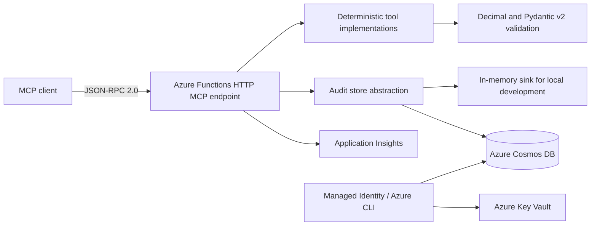

# Remote MCP Audit Server

A production-oriented Model Context Protocol (MCP) tool server implemented as an Azure Function, designed for deterministic financial and compliance operations, auditable execution, and tenant-safe retrieval.

## Architecture



The HTTP endpoint implements MCP initialization and `tools/list`/`tools/call`. Tool operations use Pydantic v2 strict schemas and Python `Decimal` arithmetic. Azure storage and credentials are isolated behind `AuditStore` implementations.

## Tools

### `validate_invoice_math`

Reconciles line-item totals, reported subtotal, tax amount, and reported total using `Decimal`, `ROUND_HALF_UP`, and cent precision. It returns exact variances and structured findings.

### `evaluate_policy_compliance`

Evaluates configured spend limits, approval tiers, VAT registration, and SLA/due-date rules. Policy evaluation is deterministic and never invokes an LLM.

### `query_audit_trail`

Queries tenant-scoped audit records, optionally filtered by tool name, with bounded limits and opaque cursor pagination. A tenant boundary is enforced in both the in-memory and Cosmos implementations.

## Deterministic vs. Probabilistic Boundary

- All money, tax, invoice, threshold, and compliance decisions use `Decimal` values from JSON strings; JSON floats and booleans are rejected.
- Pydantic v2 rejects unknown fields and validates ranges, lengths, finite decimals, and required policy fields.
- Probabilistic components, such as an LLM client, must only assist with language or recommendation workflows and must not calculate financial values or determine compliance outcomes.

## Audit and Failure Handling

Every tool invocation records:

- `trace_id` correlation ID
- `tenantId`
- tool name
- request summary
- output or error summary
- duration in milliseconds
- status and JSON-RPC error code
- UTC timestamp

Cosmos writes use `DefaultAzureCredential`, which selects Managed Identity in Azure and Azure CLI or developer credentials locally. Writes use bounded exponential backoff with jitter. Invalid JSON-RPC requests return structured JSON-RPC error objects rather than HTTP 500 responses.

## Security and Identity

- No keys, connection strings, publish profiles, or credentials are stored in source.
- Cosmos access uses Azure RBAC and `DefaultAzureCredential`.
- GitHub Actions authenticates through OIDC using `azure/login@v2`; no secrets are serialized to the deployment job.
- The HTTP route should remain function-authenticated or be placed behind an approved API gateway in production.
- Restrict Cosmos container and Key Vault role assignments to the server managed identity.

The Cosmos endpoint and database/container names may be configured by environment variables. If `COSMOS_ENDPOINT` is absent, the server uses the local in-memory audit sink.

## Cost and Latency Trade-offs

| Concern | Choice | Trade-off |
|---|---|---|
| Hosting | Linux Consumption | Low idle cost; cold starts and limited always-on predictability |
| Persistence | Cosmos DB Free Tier | Low-cost start; monitor RU consumption and partition growth |
| Audit writes | Cosmos upsert | Stronger durability; network latency and retry cost |
| Local testing | In-memory sink | Fast/offline; process-local and not durable |
| Logs | Application Insights | Production observability; ingestion/sample cost |
| Query pagination | Opaque offset cursors | Deterministic and bounded; not a distributed continuation token guarantee |

Cold starts can be reduced operationally by moving to a warmer plan, but this changes the portfolio's cost profile. Monitoring should include duration, write failures, Cosmos throttling, cold-start frequency, and per-tenant request volume.

## Local Development

Use [docs/RUN_LOCALLY.md](docs/RUN_LOCALLY.md) for the complete Python security-check, local MCP server, and React frontend setup. Use [docs/PUSH_TO_GITHUB.md](docs/PUSH_TO_GITHUB.md) for repository-root, secret-readiness, remote, and GitHub Actions guidance.

## Cloud Deployment

Deployment uses Python 3.12 consistently in:

- the local virtual environment
- GitHub Actions setup
- Azure Function runtime configuration

The deployment workflow expects these repository variables:

| Variable | Purpose |
|---|---|
| `AZURE_CLIENT_ID` | Federated Entra application/client ID |
| `AZURE_TENANT_ID` | Microsoft Entra tenant ID |
| `AZURE_SUBSCRIPTION_ID` | Azure subscription ID |
| `AZURE_FUNCTIONAPP_NAME` | Linux Function App name |

Configure Terraform or Azure policy to align the Function App runtime with Python 3.12. Configure federated credentials for the repository and branch/environment being used. The workflow uses `azure/login@v2` and `Azure/functions-action@v1` without publish-profile secrets.

Example Azure runtime settings:

```text
COSMOS_ENDPOINT=<resource-specific-account-endpoint>
COSMOS_DATABASE=mcp-audit
COSMOS_CONTAINER=audit-records
```

Do not configure Cosmos keys or connection strings. Grant the Function App managed identity the required Cosmos data-plane role and least-privilege Key Vault role separately.

## Architecture Decision Record

### ADR-001: Separate deterministic tools from probabilistic clients

**Status:** Accepted

**Context:** Financial reconciliation and policy compliance are high-consequence decisions. Floating-point arithmetic or model-generated calculations can create nondeterministic or disputed outcomes.

**Decision:** Pydantic v2 schemas and `Decimal` are mandatory at MCP tool boundaries. Monetary operations use explicit cent quantization and `ROUND_HALF_UP`. LLM or probabilistic components are not used for tool calculations.

**Consequences:** Requests must use decimal strings rather than JSON floats. Tests assert exact `Decimal` results and edge cases. External consumers gain a reproducible decision boundary at the cost of stricter input contracts.

### ADR-002: Audit store abstraction with in-memory fallback

**Status:** Accepted

**Context:** Local development must remain offline while Azure deployment requires durable audit storage.

**Decision:** Introduce `AuditStore` with in-memory and Cosmos implementations selected from `COSMOS_ENDPOINT` configuration. Cosmos writes use managed identity and bounded retries.

**Consequences:** Local behavior is convenient but ephemeral. Cosmos behavior is durable but requires Azure RBAC and network availability.

## Repository Structure

```text
function_app.py
host.json
requirements.txt
requirements-dev.txt
src/
  audit_store.py
  schemas/models.py
  tools/
    reconcile.py
    policy_check.py
    audit_trail.py
tests/test_tools.py
.github/workflows/app-deploy.yml
```
